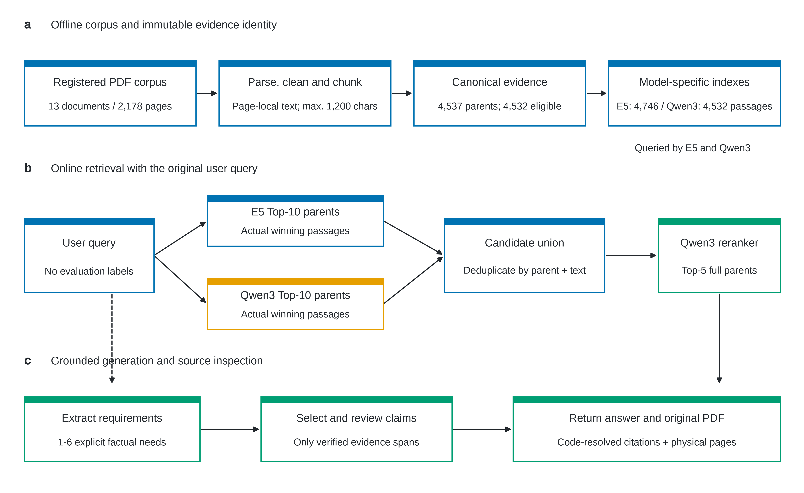
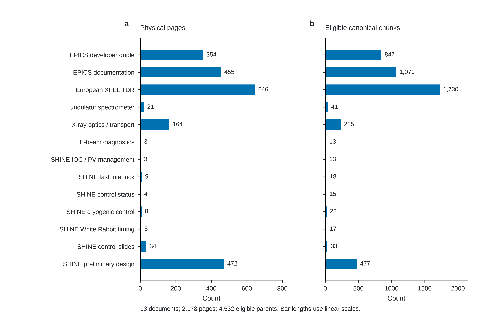
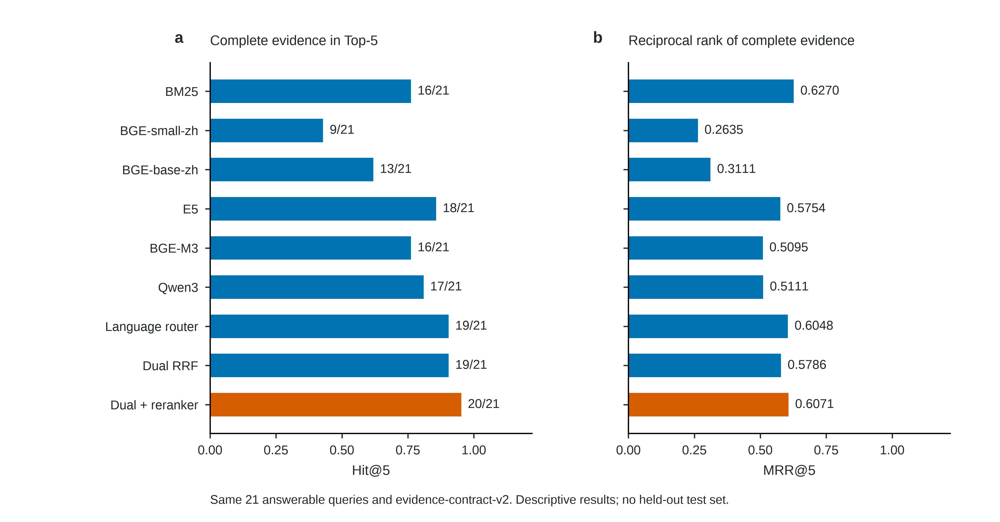
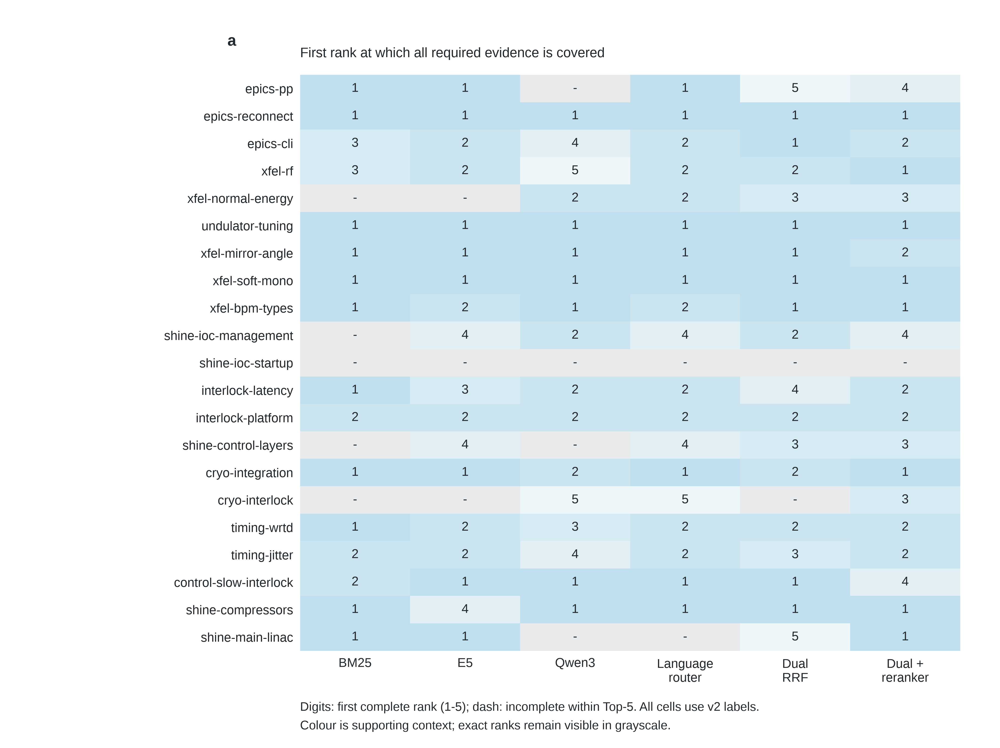
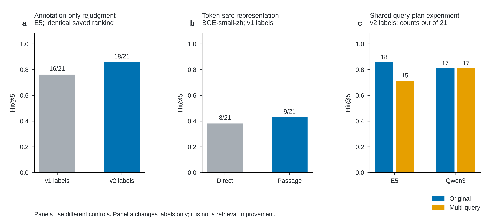
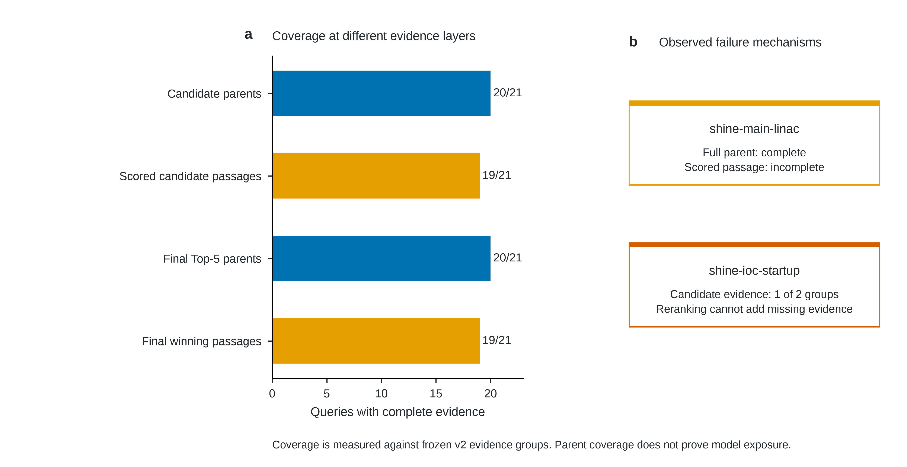
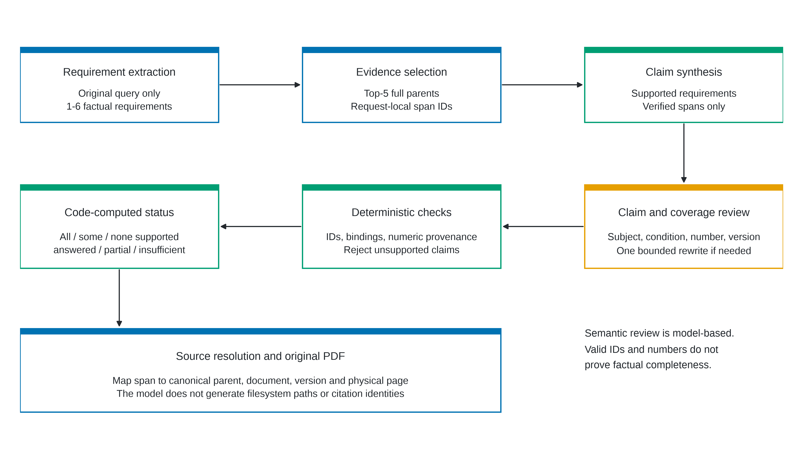
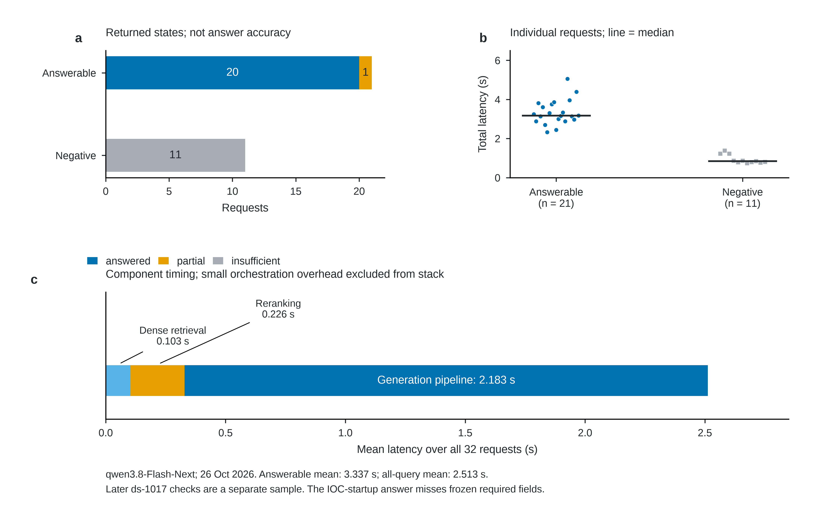

# 面向加速器技术文档的可追溯检索增强问答系统

论文 RAG 部分详细稿｜资料截止：2026 年 10 月 27 日

本章依据项目源码、冻结评测集及历史执行记录整理。研究对象是静态技术文档的知识检索与有据问答。正文可作为学位论文的独立章节；图号和参考文献编号可在合并全文时统一调整。全部实验数值来自已有记录，本次整理没有重新运行模型推理。当前稿明确区分可复核测量、系统内部判断和仍待独立验证的结论。

## 摘要

加速器技术知识分散在设计报告、控制系统文档和专题论文中。中英文混用、文档版本差异、PDF 提取损坏和复合问题的证据分散，使通用向量检索难以直接满足工程查询需求。本研究围绕 SHINE、European XFEL 和 EPICS 资料，构建了具有原文追溯能力的检索增强生成系统。系统通过文档登记、物理页解析、保守清洗和稳定分块，形成 13 份 PDF、2,178 个物理页及 4,532 个符合检索资格的规范证据块。系统将引用单位与模型输入单位分离，以 token 预算约束构造模型专用片段，并以模型、编码模板和分块策略的联合指纹约束索引兼容性。

在包含 21 条可回答问题和 11 条负例的固定诊断集上，采用完整证据组判定，比较 BM25、5 种稠密嵌入模型、多查询改写、语言路由、倒数排名融合和候选重排。统一标注下，E5 的 Hit@5 为 18/21；E5 与 Qwen3 候选合并后重排达到 20/21，MRR@5 为 0.6071。实际评分片段仅完整覆盖 19/21，表明父证据块命中与模型看到完整证据是不同事件。问答层进一步实现需求分解、证据选择、受限综合、逐项核查及代码计算状态。2026 年 10 月 26 日的 GPU 服务验收记录中，32 条冻结请求均成功返回，11 条负例均输出证据不足；可回答问题平均总耗时为 3.337 s。复核同时发现，IOC 启动信息答案被标为完整回答，却未覆盖冻结标注要求的全部字段。因此，内部核查覆盖率不能等同于独立评审的答案完整率。本研究形成了可复现、可定位原文的工程原型，并揭示了小样本检索评测、证据粒度及生成状态校准的边界。

关键词：加速器知识库；检索增强生成；跨语言检索；证据完整性；文档追溯；SHINE；EPICS

## 1 研究背景与问题定义

### 1.1 加速器文档知识服务的需求

加速器工程查询通常同时包含领域术语、参数条件和版本约束。例如，询问主加速器的工作模式及最终能量，需要完整覆盖两个事实；询问 IOC 启动时提交的信息，需要区分启动上报、数据库存储和界面展示。文档中出现相同设备名称，仅说明主题相关，不能证明文档片段已经回答了问题。

本章资料涉及实验物理与工业控制系统（Experimental Physics and Industrial Control System，EPICS）。其中，输入输出控制器（input/output controller，IOC）承载设备控制与记录处理，过程变量（process variable，PV）用于表示可访问的控制与状态数据。技术查询同时涉及英文术语、设备标识和中文工程表述，因此检索需要保留标识符并处理跨语言对应关系。

技术资料还存在明显的时间边界。设计报告中的额定值、设计指标和测试结果，可以支持相应历史条件下的陈述；它们不能直接支持当前在线 IOC 数量、实时压力或某一时刻的固件部署状态。知识服务应明确这些差别，并在证据不足时保留未确认项。

本研究将系统目标限定为：根据登记的静态技术文档，检索与问题对应的证据，生成可核查的回答，并提供原始 PDF 的文档、版本和物理页定位。系统不读取实时控制数据，不执行 EPICS 写操作。本章不将 Waveform 分析、Agent 工具编排或采集控制的工作计入 RAG 实验。

### 1.2 相关方法与本研究的位置

检索增强生成（retrieval-augmented generation，RAG）将外部检索结果作为生成条件，以补充模型参数中的知识，并提供可追溯来源 [1]。本系统采用预训练检索模型和生成模型的工程组合，没有训练原始 RAG 论文中的端到端模型，也没有进行领域微调。论文中的方法贡献主要位于证据组织、评测契约和受限问答流程。

BM25 使用词项统计计算相关性，适合保留 EPICS 命令、PV 名及设备标识等精确词汇 [2]。稠密检索将查询和文档映射到向量空间，以补充词面匹配的不足。本研究比较中文 BGE、多语言 E5、BGE-M3 和 Qwen3 嵌入模型 [3–5]。其中，BGE-M3 仅使用稠密表示；本研究没有实现其稀疏表示或多向量检索，也没有将 BM25 与稠密检索组合为混合检索。

对于不同检索器的结果，倒数排名融合（reciprocal rank fusion，RRF）通过排名形成公共分数，避免直接相加不同模型的相似度 [6]。重排器则对查询与候选文本联合评分。本文采用 Qwen3-Reranker-0.6B 官方示例中的 yes/no 评分方式 [5,7]，在固定候选范围内重排，不通过生成额外事实补齐检索缺口。

### 1.3 研究问题与工作范围

本章研究 4 个相互关联的问题。第一，如何把格式不统一的中英文 PDF 转换为具有稳定身份和物理页来源的证据。第二，如何在不改变引用单位的条件下适配不同模型的 token 预算。第三，不同嵌入模型和候选组合是否改善完整证据检索。第四，如何把检索结果转化为逐项有据、状态明确的回答。

对应的工作包括语料治理、关键词与向量检索、证据标注审核、模型比较、候选融合与重排、独立问答服务和原文浏览界面。图 1 给出实现流程。各阶段的测量口径、执行记录和代码位置列于附录，便于论文审阅时追查结论来源。



## 2 语料构建与证据表示

### 2.1 文档登记与研究语料

系统以登记表统一管理文档身份。每份文档包含唯一 ID、标题、相对来源路径、版本、语言、领域类别、主题和状态。系统以物理页定位证据，物理页从 1 开始计数，避免封面、前言或罗马数字页码造成偏移。文档标题中的年份与版本字段保留原始含义；版本为 `unknown` 时，界面显示“文档未标明版本”。

当前语料共 13 份 PDF。按登记分类，控制系统资料有 8 份，加速器物理资料有 3 份，束流诊断资料有 2 份；语言包括 10 份英文资料和 3 份中文资料。全部文档成功进入解析流程，总物理页数为 2,178，规范块累计字符数为 3,755,174。[E1,E2]

表 1 列出语料清单。表中“规范块”包括审计保留但不进入检索的内容；“可检索块”是资格筛选后的统计。图 2 同时呈现物理页和可检索块，避免把文档数量误解为知识容量相同。European XFEL 技术设计报告、两份 EPICS 文档和 SHINE 初设报告占据主要文本规模，小型专题论文虽然页数较少，仍提供 IOC、低温和定时系统等关键证据。

表 1　研究语料及规模

| 文档 | 版本或时间 | 语言 | 物理页 | 规范块 | 可检索块 |
| --- | --- | --- | ---: | ---: | ---: |
| EPICS Application Developer's Guide | R3.16.2，2018-10-22 | 英文 | 354 | 848 | 847 |
| EPICS Documentation | latest，2026-08-18 | 英文 | 455 | 1,071 | 1,071 |
| European XFEL Technical Design Report | DESY 2006-097，2007-07 | 英文 | 646 | 1,730 | 1,730 |
| Undulator Commissioning Spectrometer | Rev B，Ver 2，2011-06-08 | 英文 | 21 | 41 | 41 |
| X-Ray Optics and Beam Transport | TR-2012-006，2012-12 | 英文 | 164 | 235 | 235 |
| Standard E-Beam Diagnostics | LINAC2010 TUP095 | 英文 | 3 | 13 | 13 |
| SHINE IOC and PVs Information Management | PCaPAC2022 FRO21 | 英文 | 3 | 13 | 13 |
| SHINE 加速器快联锁系统设计与开发 | 核技术 47(12):120203，2024-12 | 中文 | 9 | 18 | 18 |
| Status of the SHINE Control System | ICALEPCS2019 WEPHA167 | 英文 | 4 | 15 | 15 |
| The Cryogenic Control System of SHINE | EPJ Techniques and Instrumentation，2021 | 英文 | 8 | 22 | 22 |
| White Rabbit Based Beam-Synchronous Timing | IPAC2022 THIYGD1 | 英文 | 5 | 17 | 17 |
| SHINE 加速器控制系统设计与开发 | 文档未标明版本 | 中文 | 34 | 34 | 33 |
| 硬 X 射线自由电子激光装置初步设计报告（加速器分册） | 2017-12-26 | 中文 | 472 | 480 | 477 |
| 合计 | 13 份 PDF | 中英文 | 2,178 | 4,537 | 4,532 |



### 2.2 PDF 解析与保守清洗

解析器使用 PyMuPDF 提取文本块，保留块类型、坐标、页面尺寸和图像数量。原始解析结果与检索用清洗文本分开保存。系统可以追查某段文本的物理来源，而不依赖模型重建页码。

清洗首先识别页边重复文本和固定位置的运行页眉、页脚。普通页边重复检测要求签名至少出现在 2 页；较宽边距区域的固定位置重复检测，还要求出现次数达到 6 页或文档页数的 10%，取二者较大值。算法保守删除页码、出版标识和可确认的页边重复内容。它不会按文件名或出版社配置特殊清洗规则。

英文换行断词的合并依赖文档内词汇证据。只有连写形式在文档中出现，且相同的带连字符形式没有完整出现时，算法才合并换行断词。普通技术连字符予以保留。两栏阅读顺序使用文本块坐标恢复，跨栏块作为纵向分隔；这是几何启发式，不能视为通用版面理解。

对学术论文，清洗器仅在第一页明确出现摘要边界时移除前置标题和作者信息；仅在最后一页出现参考文献标题及多条编号文献时移除尾部列表。无法确认的内容继续保留。这样的策略优先保持工程语义，代价是仍可能存在残余噪声。[E2,E15]

当前流程没有实现 OCR、复杂表格重建或公式语义识别。字符损坏审计在 SHINE 初设报告中发现替换字符；资格筛选只删除以损坏字符为主的块，少量公式损坏的正文仍可能进入知识库。因此，论文应把 PDF 提取质量列为独立误差来源，不能以“成功解析全部文档”推断全部知识已经无损入库。

### 2.3 规范证据块与稳定身份

规范证据块（canonical KnowledgeChunk，以下简称父块）是引用和评测的基本单位。`pdf-chunks-v3` 在每个物理页内聚合文本，再按自然段、句子和空白优先级分割。默认上限为 1,200 个字符，下限 300 个字符仅用于尽量避免过短片段。每页尾部、短页及实际分割边界可能产生小于 300 个字符的块。规范分块不跨页，也不设置重叠。

块 ID 由算法版本、分块配置、文档 ID、文档版本、物理页、页内序号和清洗后文本共同计算 SHA-256。来源路径和标题作为元数据保留。只要参与身份计算的内容变化，块 ID 就会变化；同一份冻结语料中的引用可稳定追溯。

父块同时保留正文、标题、版本、语言、领域、主题、来源路径及物理页范围。来源路径必须是 `data/l0_raw/` 下的规范相对路径，禁止绝对路径与上级目录穿越。对外响应只提供登记文档的访问路由，不暴露服务器真实路径。

### 2.4 检索资格筛选

系统将语料审计与检索准入分离。全部 4,537 个规范块进入审计，其中 4,532 个进入检索。排除项包括 1 个仅含数字或出版代码的块、1 个套话块，以及 3 个主要由替换字符组成的块。替换字符排除条件同时要求数量不少于 8 个、占非空白字符比例不少于 20%。

这些阈值是当前实现的保守规则，不是经独立实验优化出的最优参数。它们避免直接丢弃所有包含损坏公式的正文，也意味着知识库中仍保留部分不可完整解释的公式或表格内容。资格筛选不将证据相关性、问题标签或检索排名作为输入。

## 3 模型输入片段与索引一致性

### 3.1 引用单位与编码单位的分离

字符长度不能直接保证模型输入适配。Stage 2.5 使用 BGE-small-zh-v1.5 时，4,532 个输入中有 376 个超过 512 tokens，占 8.30%。中文父块中有 300/528 超限，英文父块中有 76/4,004 超限。统计包含标题、正文、模型前缀和特殊 token，不能只按正文字数估计。[E3]

为保留稳定引用，系统不根据某个模型重新定义规范块，而是从父块中构造模型专用片段（embedding passage）。每个片段必须是父文本中的精确非空子串，记录字符起止位置、片段序号、token 数和父块 ID。片段用于向量表示与评分，父块继续用于引用、最终上下文和冻结评测。

设模型序列上限为长度预算，标题、前缀和特殊 token 的实际开销为模板开销。对需要分割的父块，初始正文预算按式（1）确定。

$$
B_m=L_m-H_m-G,
$$

式（1）中，模型上限记为 \(L_m\)，模板开销记为 \(H_m\)，保护余量记为 \(G\)。当前保护余量为 16 tokens，邻接片段重叠为 32 tokens。实现优先在窗口后半段寻找自然边界，再对完整编码模板重新计数；如超预算，继续缩小窗口。原本已经适配的完整父块保持原状，不强制扣除保护余量。

构造完成后，系统再次对全部最终模板独立计数。所有片段均通过预算检查后才允许向量写入。这一约束防止静默截断，但不保证嵌入模型一定能正确表达片段中的工程关系。

### 3.2 模型专用编码契约

模型使用各自明确的查询模板和文档前缀。E5 查询使用 `query: `，文档使用 `passage: `；中文 BGE 使用核实过的中文检索指令；BGE-M3 采用对称编码；Qwen3 使用领域检索 instruction 和查询模板。文档主体统一为标题加换行加片段正文。模型权重在测量前单独准备，正式编码只从本地加载。

表 2 列出实际记录的模型配置。片段数量随 tokenizer 和序列上限变化，因此不同模型的索引点数不要求相等。它们必须映射回相同的 4,532 个合格父块，才能进行统一的引用级比较。[E4–E6]

表 2　实际使用的稠密检索表示

| 模型 | 向量维度 | 实际序列上限（tokens） | 编码片段数 | 输入规则 |
| --- | ---: | ---: | ---: | --- |
| BAAI/bge-small-zh-v1.5 | 512 | 512 | 4,950 | 中文查询指令；文档无指令前缀 |
| BAAI/bge-base-zh-v1.5 | 768 | 512 | 4,952 | 中文查询指令；文档无指令前缀 |
| intfloat/multilingual-e5-base | 768 | 512 | 4,746 | `query: ` / `passage: ` |
| BAAI/bge-m3 | 1,024 | 8,192 | 4,532 | 对称稠密编码 |
| Qwen/Qwen3-Embedding-0.6B | 1,024 | 32,768 | 4,532 | 查询 instruction；文档无前缀 |

### 3.3 相似度与父块聚合

模型对查询和文档嵌入进行归一化，使用余弦相似度。对同一父块的多个片段，系统取已检索片段中的最高分，恢复对应父块。数学表示为式（2）。

$$
s_m(q,c)=\max_{p\in\mathcal{P}^{\mathrm{ret}}_m(c,q)}\frac{\mathbf{e}_m(q)^{\mathsf{T}}\mathbf{e}_m(p)}{\Vert\mathbf{e}_m(q)\Vert_2\Vert\mathbf{e}_m(p)\Vert_2}.
$$

式（2）中的集合只包含该次向量搜索实际返回的子片段，实际实现通过过采样及必要时扩大搜索池获得足够父块。它不表示每次查询都穷举全部片段。系统保留最高分子片段的 ID、文本及父块对应关系，用于后续诊断和重排。不同模型的余弦分数不直接比较或相加。

### 3.4 索引契约与只读生命周期

同维向量不一定来自同一向量空间。例如，BGE-base-zh 和 E5 都产生 768 维表示，但不能共享彼此建立的索引。系统使用 `DenseIndexContract` 绑定模型名称、权重清单摘要、模型配置、编码配置、tokenizer、查询模板、文档前缀、维度、序列上限、归一化、距离与片段策略。

契约采用稳定 JSON 序列化和 SHA-256 形成身份。路径、线程、批大小和测量耗时不参与身份计算。每个索引点保存契约及摘要；无签名或混合契约的集合拒绝使用。对同一契约的增量替换只更新目标文档，避免误删其它文档。

历史实验接口在必要操作前核验契约。生产运行在启动时完成全量核验，然后冻结索引写入；请求内搜索不再重复全库扫描。这一调整减少运行开销，同时保留模型和索引兼容性检查。生产索引的 E5 与 Qwen3 点数分别为 4,746 和 4,532。[E12,E15]

## 4 证据级评测设计

### 4.1 查询集及其适用范围

固定评测集包含 32 条问题，其中 21 条可回答问题和 11 条负例。可回答问题包含 13 条英文问题和 8 条中文问题，覆盖 EPICS、加速器设计、IOC、快慢联锁、低温、束流诊断和定时系统。按标注中的目标语言保守分类，存在跨语言目标的问题有 3 条。负例包括 3 条明显域外或无效问题，以及 8 条要求特定时刻运行数据的领域负例。[E7]

该查询集用于持续开发诊断，已经被多轮模型比较、标注审核和方案选择使用。它不是独立保留测试集。较小的主题切片尤其不足以支持“某模型适用于全部中文问题”或“跨语言能力普遍提高”等结论。后续扩展应分别覆盖版本冲突、对象混淆、超出文档范围的事实、证据互相矛盾及真实运行数据缺失。

### 4.2 证据组、可接受来源与匹配规则

每个可回答问题包含一个或多个证据组。每组可有多个等价来源；同组内任一来源匹配即可。默认 `all` 模式要求覆盖全部组，`any` 模式只要求覆盖任一组。当前 21 条可回答问题合计包含 35 个冻结证据组，数量与问答阶段模型分解出的要求数不同。

一个来源目标同时绑定文档 ID、物理页和原始摘录。命中要求三者同时成立：文档正确，父块覆盖目标物理页，规范化摘录是父块正文的子串。同页另一块文本不自动相关。规范化仅处理 NFKC、大小写、空白、NULL 和特定英文换行断词，不使用向量相似度或模糊编辑距离作为真值判据。

设查询的第一个到第若干个检索父块形成 Top-K 集合。第 g 组是否得到覆盖，由式（3）表示。

$$
a_{qg}(K)=\mathbf{1}\left[\exists c\in\mathcal{R}_K(q),\ \exists t\in\mathcal{A}_{qg}:\operatorname{match}(c,t)\right].
$$

在 `all` 模式下，完整命中条件为式（4）。`any` 模式将乘积替换为“至少一个组满足”。

$$
I_q(K)=\prod_{g=1}^{G_q}a_{qg}(K).
$$

标注加载时逐条验证所有备选摘录：摘录既要存在于原始物理页，也要存在于至少一个合格父块。若清洗或分块破坏了所有可检索证据，程序直接报标注校验失败，避免将数据问题计成检索失败。

### 4.3 Hit@K 与完整首次排名

本文的 Hit@K 是可回答问题中，Top-K 已满足证据组要求的问题比例。它不是“检出任意同主题段落”的比例，也不是文档召回率。只有 21 条可回答问题进入分母，如式（5）所示。

$$
\mathrm{Hit@}K=\frac{1}{|\mathcal{Q}_{+}|}\sum_{q\in\mathcal{Q}_{+}}I_q(K).
$$

完整首次排名是首次覆盖所需证据的排名。它可以由多个结果共同完成，而不要求某一个结果单独包含全部证据。前 5 个结果均未完整时，倒数排名贡献记为零。

$$
r_q=\min\{k\in\{1,2,3,4,5\}:I_q(k)=1\}.
$$

$$
\mathrm{MRR@5}=\frac{1}{|\mathcal{Q}_{+}|}\sum_{q\in\mathcal{Q}_{+}}\frac{\mathbf{1}[r_q\leq 5]}{r_q}.
$$

式（6）的集合为空时，将首次完整排名记为无穷大，并将式（7）中该项贡献定义为零。本文采用这一实现约定，不将单条相关片段的首次排名混入 MRR@5。

### 4.4 标注审核与离线重判

Stage 2.7.1 对全部 21 条问题重新审核等价证据，在全部 13 份 PDF 中进行术语、规范化文本和宽松候选搜索。审核在 11 条问题中增加 39 个可接受来源，使备选摘录总数从 37 增加到 76。组间语义和 `all` / `any` 规则保持不变。[E5]

该阶段使用保存的排名和完整父块重新判断，没有重新检索、重新编码或改写文档向量。对 E5，v1 标注下的 Hit@5 为 16/21，v2 为 18/21；这个变化来自可接受来源范围的修正，不能解释为检索算法改善。BM25 的 Hit@5 同样由 15/21 变为 16/21。

审核是在观察早期排名后进行的，虽然增加的每条证据均通过原文和合格父块双重验证，仍可能存在对已观察结果的适应。表 3 的最终横向比较统一使用 v2 标注；历史 A/B 实验保持其测量时的 v1 口径，不与最终横向结果混合计算提升幅度。

### 4.5 完整性与复现控制

每轮报告保存查询集、PDF、规范父块、模型权重、源码和索引契约的摘要。模型运行时仅接收问题、候选证据及输出协议；冻结标签和预期判断由本地评测器在结果返回后使用。多查询实验的 QueryPlan 也只由原始问题产生。

本次论文整理从保存的父块正文重新执行了证据子串匹配，重算 11 种方法的 Hit@1、Hit@3、Hit@5 和 MRR@5，共核对 231 条可回答排名；所有重算结果与报告一致。服务部分重算了 32 条请求的延迟均值与状态规则。上述核验使用历史记录，不等同于重新运行原始 PDF 解析或真实 GPU 实验。

## 5 检索方法与实验结果

### 5.1 BM25 与单模型比较

BM25 将标题与正文联合分词。中文使用 Jieba，英文缩写和标识符进行大小写折叠；PV 名、数字和技术词由专用模式提取。实现采用正值 IDF，参数 `k1` 为 1.5，`b` 为 0.75。BM25 分数不归一化，也不与稠密分数直接比较。[E15]

在 v2 统一标注下，E5 是本组实验中 Hit@5 最高的单一稠密检索器，达到 18/21。Qwen3 为 17/21，BGE-M3 为 16/21。BGE-base-zh 相比 BGE-small-zh 提高完整覆盖，但仍低于 E5。这个结果说明，在当前中英文混合语料上，单纯增加中文模型规模或序列长度没有保证更高的完整证据命中率。

BM25 的 Hit@1 为 0.5238，MRR@5 为 0.6270，均高于最终重排方案；其 Hit@5 为 16/21，低于后者的 20/21。该结果反映目标之间的差别：BM25 在部分精确词项问题上较早获得完整证据，双模型重排则扩大了前 5 个结果的完整覆盖。论文不应笼统宣称重排在全部排名指标上优于 BM25。

表 3　统一使用 evidence-contract-v2 的检索结果

| 方法 | Hit@1 | Hit@3 | Hit@5 | MRR@5 | 完整命中数 |
| --- | ---: | ---: | ---: | ---: | ---: |
| BM25 | 0.5238 | 0.7619 | 0.7619 | 0.6270 | 16/21 |
| BGE-small-zh | 0.1905 | 0.2857 | 0.4286 | 0.2635 | 9/21 |
| BGE-base-zh | 0.1429 | 0.4762 | 0.6190 | 0.3111 | 13/21 |
| E5 | 0.3810 | 0.7143 | 0.8571 | 0.5754 | 18/21 |
| BGE-M3（仅稠密） | 0.3333 | 0.7143 | 0.7619 | 0.5095 | 16/21 |
| Qwen3-Embedding-0.6B | 0.3333 | 0.6190 | 0.8095 | 0.5111 | 17/21 |
| E5 多查询改写 | 0.3810 | 0.6190 | 0.7143 | 0.5159 | 15/21 |
| Qwen3 多查询改写 | 0.3333 | 0.6190 | 0.8095 | 0.4849 | 17/21 |
| 语言路由 | 0.3810 | 0.7619 | 0.9048 | 0.6048 | 19/21 |
| E5 + Qwen3 RRF | 0.3810 | 0.7619 | 0.9048 | 0.5786 | 19/21 |
| E5 + Qwen3 + 重排 | 0.3810 | 0.8095 | 0.9524 | 0.6071 | 20/21 |

注：全部方法在相同 21 条可回答问题上计算，负例不进入分母。图 3 显示主要原始查询方法，图 4 展示逐问题首次完整排名。表中差别是固定开发样本上的描述性差别；未进行独立保留集检验。





### 5.2 Token-safe passage 的受控比较

Stage 2.6 比较直接编码父块与 token-safe passage 表示，固定语料、父块身份、资格筛选和 v1 标注。直接编码对照复用历史向量，保留其真实截断行为；新方案将 376 个过长父块分割，生成 4,950 个片段，最大输入为 512 tokens，超限片段为零。[E4]

该实验的 Hit@5 从 8/21 提高到 9/21，MRR@5 从 0.1802 提高到 0.2040。新增完整命中仅为 `interlock-latency`，没有完整命中回退。需要强调，该问题的目标证据原本就位于直接编码的可见范围内，改善不能归因于恢复被截掉的目标证据。

在原直接编码方案的 13 条失败问题中，有 3 条相关父块超出输入上限，仅 `shine-compressors` 的必需摘录跨越可见边界。新方案完整覆盖父文本后，该问题仍未命中目标页。这说明截断确实存在，但在当前样本中不足以解释多数检索失败。Token-safe 机制首先解决输入有效性，而不是自动解决领域语义选择。

### 5.3 多查询改写的结果与代价

多查询实验由 `qwen3-vl` 为每个原始问题生成最多 3 个独立检索意图。提示要求保留技术标识、数字和全部信息需求，对可能来自英文资料的问题使用英文检索措辞。相同 QueryPlan 同时用于 E5 和 Qwen3，避免两个模型使用不同改写造成混杂。融合包含原始查询，沿用已有文档向量，不重新编码语料。[E6]

E5 加多查询的 Hit@5 从 18/21 降到 15/21，MRR@5 从 0.5754 降到 0.5159。Qwen3 的 Hit@5 保持 17/21，MRR@5 从 0.5111 降到 0.4849。两种方案都没有解决 IOC 启动信息问题。因此，当前实现没有将多查询改写固化为默认检索路径。

这些结果支持“该配置未在当前样本上带来稳定收益”，不能支持“多查询方法普遍无效”。可能原因包括改写丢失限定条件、意图分散和融合稀释原始排名，但尚缺少逐因素受控实验。本章将这些机制保留为待验证解释，不视为已证实因果。



### 5.4 模型互补性、语言路由与 RRF

E5 与 Qwen3 的单模型成功集合存在互补。两者同时命中 15 条问题，E5 独有命中 3 条，Qwen3 独有命中 2 条，两者都未完整命中 1 条。成功集合的并集为 20/21，但这只是按已知标签计算的诊断上界，不是可直接部署的选择规则。

语言路由仅依据原始问题是否包含明显汉字选择模型：英文使用 E5，中文使用 Qwen3，不读取问题 ID 或评测标签。它达到 19/21，MRR@5 为 0.6048。该方法每次只进行一次查询编码与搜索，但部署时仍需维护两套模型和索引。中文 `shine-main-linac` 在 E5 中完整命中，在 Qwen3 中未完整，因此语言本身不足以确定最佳检索器。

双模型 RRF 对两路各前 10 个父块等权融合，固定常数为 60，并按父块 ID 去重。同分时按父块 ID 稳定排序。公式见式（8），未出现在某一路候选中的父块不获得该路贡献。

$$
s_{\mathrm{RRF}}(q,c)=\sum_{m\in\mathcal{M}:\,c\in\mathcal{C}_m(q)}\frac{1}{60+\operatorname{rank}_m(q,c)}.
$$

RRF 的 Hit@5 同样为 19/21，MRR@5 为 0.5786。它保留 `shine-main-linac`，但 `cryo-interlock` 只覆盖 3 组中的 2 组。语言路由和 RRF 虽然总命中数相同，失败问题并不相同；只看汇总比例会掩盖这个差别。[E8]

### 5.5 双模型候选重排

最终检索方案对原始查询分别执行 E5 与 Qwen3 搜索，各取前 10 个规范父块。候选以父块 ID 合并。重排输入只使用各模型实际命中的最高分片段；同一父块中不同文本分别评分，完全相同文本合并并保留来源。每个父块取其候选片段中的最高重排分数，最后返回前 5 个完整父块。

Qwen3-Reranker-0.6B 使用官方固定 instruction 和提示前后缀，取末位置的 yes/no logits，按式（9）归一化为重排分数。这个分数用于排序，不是已经校准的“答案正确概率”。[7,E9]

$$
s_{\mathrm{rr}}(q,p)=\frac{\exp(z_{\mathrm{yes}})}{\exp(z_{\mathrm{yes}})+\exp(z_{\mathrm{no}})}.
$$

CPU 实验使用 FP32、6 个线程、左填充、批大小 4 和 8,192 tokens 的输入上限。32 条查询共评分 537 对查询片段，平均每条查询包含 16.25 个父块、16.78 个片段；最长输入为 839 tokens，没有截断。模型加载约 1.26 s，累计重排约 801.83 s，平均每条查询约 25.06 s。该值属于 CPU 实验，不能作为 GPU 服务延迟。

最终方案 Hit@5 为 20/21，相比 E5 增加 `xfel-normal-energy` 与 `cryo-interlock` 两条完整命中，没有丢失 E5 已完整命中的问题；Hit@5 增加 9.52 个百分点。MRR@5 从 0.5754 提高到 0.6071。Hit@1 均为 0.3810，说明主要变化出现在前 3 至前 5 个结果的证据覆盖，而非首位完整命中。

### 5.6 候选父块、评分片段与最终上下文的差别

双模型前 10 个父块并集在 20/21 条问题上完整；实际进入重排的片段在 19/21 条问题上完整。最终前 5 个父块完整覆盖 20/21，最终获胜片段完整覆盖 19/21。图 6 分开给出四个数值。它们是不同证据层次的观察，不应画成共享单位的转化漏斗。

`shine-main-linac` 是关键反例。规范父块同时包含工作模式与能量，但实际评分片段没有完整覆盖冻结摘录。父块最终排名命中，不能证明重排器已经阅读并判断了全部必需事实。后续生成阶段使用完整父块，因此生成模型获得的上下文又不同于重排器输入。

`shine-ioc-startup` 的候选仅覆盖 2 组中的 1 组，是最终唯一未完整命中的问题。重排只能重排已有文本，无法创造缺失证据。应先区分候选召回不足、片段选择不足和排序不足，再决定扩充语料、改进表示或调整候选策略。本次没有为该问题增加专用规则或修改冻结标注。[E9]



## 6 有据问答与原文追溯

### 6.1 从片段摘录到逐项有据回答

最初的独立问答闭环采用证据摘录、必要时翻译及代码解析引用。GPU 上 32 条请求均成功返回，检索维持 20/21，33 条引用均可解析到真实块和物理页；11 条负例均输出证据不足。然而，人工检查发现主加速器问题只回答能量而遗漏模式，EPICS 命令问题漏掉读取命令，压缩器问题缺少完整位置选择理由。部分答案仍被标为 `answered`，当时结论为部分完成。[E10]

这些反例说明，合法引用与正确检索不是完整回答的充分条件。生成层需要显式记录问题要求，核查最终文字是否覆盖各项，而不能只让模型输出一个总体状态。

### 6.2 需求提取、证据选择与受限综合

当前流程首先从原始问题提取 1 至 6 个明确事实要求，ID 按 `R1` 至 `R6` 连续编号。语言和格式要求只作为输出约束，不计入事实要求。需求提取看不到检索内容，以减少因候选资料而扩张或改写问题的风险。

证据上下文最多包含 5 个完整规范父块。每块分配请求内来源 ID，并生成可选择的句级 span。以代词或指代性词语开头的句子会保留前句上下文，避免脱离主语。完整父文本仍保留在选择阶段上下文中，句级 span 只是引用和综合的临时单位，不改变索引与规范块。

证据选择逐项返回是否支持及 span ID。代码检查要求顺序、唯一性、支持标记与片段存在性；不能在没有 span 的情况下声明支持。综合阶段仅接收已支持要求、已验证片段、文档标题和版本，不再接收完整问题与全部检索结果。每条 claim 绑定对应要求与片段，不允许加入外部常识补答。

综合后的核查再次检查主体、条件、时态、数值、原因及列表项的覆盖。第一次核查失败时，只允许用相同证据重写一次；仍未通过的结论被移除。多个要求共用同一不可靠 claim 时，拒绝状态会传播到相关要求，避免保留依赖该 claim 的完整标记。图 7 展示这一流程。[E12,E15]



### 6.3 确定性检查与输出状态

代码拒绝不存在的来源 ID、重复要求、非法 JSON 和超出结构协议的字段。每条 claim 中的数字必须出现在绑定片段、文档标题或版本元数据中，阻止新增无来源参数或自行计算的差值。这个检查验证数值来源，不验证单位换算、设备归属或语义关系；同一数字被错误用于另一对象时，仍需要语义核查。

最终状态由核查后仍受支持的要求数量决定。全部支持输出 `answered`，部分支持输出 `partial`，全部不支持输出 `insufficient`。模型不直接产生最终状态。该规则能够保证状态与内部支持标记一致，但支持标记的语义正确性仍依赖需求拆分、证据选择和模型核查。

时间保护使用确定性规则识别实时读数、当前在线数量、固件版本，以及证据中无法支持的指定时间。静态资料不能证明相应运行状态时，相关要求被标为未支持。规则是工程约束，依赖语言模式和上下文，不构成对所有时间表达的完备识别证明。

### 6.4 引用解析、版本保留与接口

模型仅选择请求内证据身份，不能生成真实文件路径、规范块 ID 或物理页。代码把选中 span 映射回父块，再解析为文档 ID、标题、版本、物理页范围和原文引文。多文档参数保留各自版本，不对不同年份或参数定义求平均。引用可解析证明来源身份存在，不自动证明该来源足以支持全部回答。

独立 API 使用 `POST /v1/rag/answer`，请求只包含 `query`。响应包含答案、状态、要求支持情况、引用和分阶段耗时。单次问题长度限制为 1 至 8,000 个字符；服务不把浏览器历史自动拼接到后续模型请求。生成协议采用结构化 function call，限制温度、输出长度及思考模式；代码对无法核验的输出返回明确错误，不把非法引用直接展示给用户。

共享 GPU 检索部分串行保护，需求提取、综合和核查使用请求内状态，可以在不同请求间并发。生产验收记录中的两个并发问题均成功返回，总墙钟耗时 4.02 s，小于两个请求耗时之和 6.96 s；这只能证明当时没有整请求全局串行，不能作为系统吞吐量或大规模并发承诺。

### 6.5 知识库目录与阅读界面

独立网页在同一服务中提供提问、回答、来源检查与 PDF 阅读。目录直接根据实际加载的两套索引构建，对文档和父块去重，显示 13 份 PDF 和 4,532 段内容。目录支持名称、版本、主题检索及领域筛选，不提供上传、删除或索引重建。[E14]

引用点击后进入页内 PDF 阅读器，支持物理页跳转、翻页、缩放和适宽。Markdown、KaTeX、PDF.js 与字体随服务部署，不依赖运行时公网 CDN。回答中的数学公式保留 LaTeX 源码并由 KaTeX 渲染；这一显示能力不代表系统具备原 PDF 中复杂公式的可靠解析能力。

生产 API 按文档登记 ID 返回 PDF，不接受任意文件路径。目录、静态页面和原文查看验证属于可用性及来源导航证据，应与问答语义质量分开报告。

## 7 服务验证、失败案例与性能

### 7.1 完整冻结集验证的模型与日期

2026 年 10 月 26 日完整验收使用生成模型标识 `qwen3.8-Flash-Next`，检索与重排运行于 GPU。E5 和 Qwen3 查询编码使用 FP32，重排使用 GPU 支持的 BF16。模型标识来自项目实际服务配置，本章不据名称推断未经记录的模型版本或参数规模。[E12]

32 条冻结集请求全部返回 HTTP 200；21 条可回答问题的返回状态为 20 条 `answered`、1 条 `partial`，11 条负例均为 `insufficient`。冻结集引用检查为 31 条合法、零条非法或不可解析；13 份 PDF 的远端与本地哈希一致。另有 10 条自由问题作为补充检查，它们未纳入冻结集延迟与检索指标分母。

报告统计 33 个模型提取的事实要求，其中 32 个被内部流程标记为支持，状态计算不一致为零。该分母既不同于 35 个冻结证据组，也不同于 21 条问题。将 32/33 写为“答案准确率 96.97%”会混淆评价单位与判定来源，本章不采用该表述。

表 4　完整验收中的观测及可支持结论

| 项目 | 保存记录 | 结论边界 |
| --- | --- | --- |
| 冻结请求 | 32/32 返回 HTTP 200 | 接口请求成功，不代表语义正确 |
| 可回答问题状态 | answered 20；partial 1 | 系统返回状态分布 |
| 负例状态 | insufficient 11/11 | 当前负例样本的拒答行为 |
| 检索完整命中 | 20/21 | v2 父块证据契约下 Hit@5 |
| 内部要求支持 | 32/33；状态不一致 0 | 内部核查与代码状态一致 |
| 冻结集引用 | 31 条可解析 | 引用身份和页范围有效 |
| 已知漏项回归 | 3/3 完整覆盖 | EPICS 命令、主加速器、压缩器的局部回归 |
| 原始 PDF 一致性 | 13/13 哈希一致 | 测量来源文件一致 |
| 独立盲审正确率 | 未测量 | 无法给出未知问题准确率保证 |

### 7.2 本次复核发现的完整性反例

`shine-ioc-startup` 的保存答案写道，IOC 启动后提交服务器地址、安装路径及维护的全部 records，并标为 `answered`。该陈述有直接引文支持，不能简单归为无来源幻觉。但冻结问题要求覆盖两组信息，涉及启动时间以及 CA server/repeater 端口等字段；保存答案没有这些字段，也没有说明字段清单不完整。

因此，该例在固定完整性口径下仍不满足完整回答。报告中的内部要求只保留“提交哪些信息”这一大项，模型核查把部分清单视为充分。代码正确地根据内部标记计算了状态，却无法纠正这个语义层面的漏项。附录 C 保存了具体对照，避免只引用历史报告的“生产通过”标签。[E7,E12]

这个反例不能据单例直接重算全部答案的独立准确率，因为其它问题尚未按统一人工量表逐一盲审。本章把“20 条 answered”和“32/33 内部支持”保留为系统行为统计，将“全部 answered 语义完整”列为尚未成立的结论。后续应为枚举类问题设计完整字段清单评审，并扩大独立核查样本。

### 7.3 部分回答与跨版本参数

低温 PLC/CPLD 组合问题在检索中完整命中，但最终回答对主联锁 PLC 部分给出证据，对 CPLD 部分明确列为未确认，状态为 `partial`。这体现出另一类差别：检索证据存在，不保证生成与核查流程能够完整利用。它与 IOC 问题一起表明，检索与生成的成功集合既不相同，也不能用相同百分比替代。

European XFEL 运行能量问题涉及不同时期文档中的正常运行、最大设计能量和参数表口径。系统需保留文档及年份，不能仅因检索到两个能量数值就形成统一比较。该案例用于检查版本边界和条件限定，不用于推出装置当前实际运行参数。

主加速器模式与最终能量、EPICS 读写监测工具、两级压缩器位置理由，是早期摘录流程的三个漏项案例。后续验收报告保存了修复后覆盖记录。此类定向回归证明已知缺陷得到针对性检查，但不替代新问题上的系统性评价。

### 7.4 请求耗时与性能口径

冻结集 32 条请求的平均耗时为：稠密检索 0.103 s，重排 0.226 s，生成流程 2.183 s，总耗时 2.513 s。生成流程包括需求提取、证据选择、综合和核查，不是单次模型输出耗时。各部分相加与总耗时之间存在少量上下文组织开销。

仅统计 21 条可回答问题时，平均总耗时为 3.337 s，中位数为 3.178 s；对应平均检索、重排与生成流程分别为 0.114 s、0.195 s 和 3.028 s。图 8 展示两类问题的逐条总耗时，避免用负例的快速返回掩盖正常回答成本。

首次模型加载、冷启动、SSH 转发和客户端渲染不计入这些服务内部耗时。本实验没有重复负载实验，没有报告尾延迟置信区间，也没有覆盖生产规模并发。CPU 历史重排与 GPU 服务的耗时既有硬件差异，也有运行实现变化，不应据此计算单一因素的加速比。



### 7.5 后续模型切换的单独记录

2026 年 10 月 27 日，服务生成模型切换为 `ds-1017`。切换验证包含 6 条代表性 API 问题，均返回 HTTP 200，总耗时为 1.344 s 至 10.841 s。随后目录与答案展示更新又验证了 5 条真实生产问题。两批问题可有主题重合，不能将它们简单视为独立随机测试样本。[E13,E14]

这些验证确认了典型完整回答、部分回答、拒答和页内原文定位的运行行为，没有重新执行 32 问完整评测。因此，本章保留 `qwen3.8-Flash-Next` 的完整验收统计，不将其迁移到 `ds-1017` 名下，也不把新模型的代表性耗时与旧模型的总体均值直接比较。

## 8 讨论与局限

### 8.1 可以由当前证据支持的贡献

本研究的第一项贡献是建立了引用身份与模型输入粒度分离的文档处理流程。父块保持稳定物理来源，片段适应模型 token 上限，索引契约防止同维异空间或模板不兼容的模型误用。这些设计降低了实验和部署中难以察觉的输入及索引错误。

第二项贡献是形成了可执行的证据完整性评价。判定绑定文档、物理页及摘录，支持组内等价来源、组间完整覆盖，并可在保留排名的条件下离线重判。该机制揭示了标注扩充与算法改善的差别，也支持保存逐条失败证据，而不只保留汇总分数。

第三项贡献是比较了多种候选策略，在固定诊断集上确认 E5 与 Qwen3 的互补性，并以候选重排将父块完整 Hit@5 提高到 20/21。该结论是工程方案选择证据，没有建立新型检索算法优越性的普遍证明。

第四项贡献是把需求、片段、claim、引用与状态连接为可审计的问答链路，并实现原文浏览服务。它解决了多项已知漏答和引用身份问题，同时保留了 IOC 清单漏项等反例，明确当前语义核查仍有校准缺口。

### 8.2 评价偏差与统计限制

21 条可回答问题每增加或减少 1 条完整命中，Hit@5 就变化约 4.76 个百分点。最终相对 E5 的增益来自 2 条问题；这个规模不足以支持稳健的总体效果估计。多个方案在相同开发集上反复比较，还存在选择偏差和开发集过拟合风险。本章不报告基于独立随机样本假设的总体置信区间，也不声称统计显著。

文档规模不均衡，问题数量也不是按全部工程任务的真实分布抽样。较长报告对向量空间的贡献更大，少数专题论文却可能承担多个关键问题的真值。当前标注只审核了所选问题，尚未证明全部等价表达都已经穷尽。无命中可能来自检索失败，也可能来自未接受的等价表述，需要保留原文核查。

生成语义核查与回答使用相同 Provider，没有独立评审模型或双人盲审。需求拆分也由模型完成，较宽的要求可能掩盖列表或条件漏项。IOC 反例已经表明，仅检查 ID、数字和内部状态一致性不能证明答案完整。

### 8.3 未完成工作与论文结论边界

当前尚未完成 OCR、复杂表格和公式结构恢复、PPTX/DOCX 解析、关键词与向量混合检索、独立保留测试、系统性人工答案评审、置信度校准，以及生产负载下的尾延迟测量。系统也没有利用实时数据库补齐运行状态。后续 Agent 或 Knowledge Capability 接入，应作为独立扩展说明。

负例在检索阶段仍会得到相关候选。11/11 输出证据不足来自后续问答约束和时间保护，不是已经找到适用于所有模型的通用分数阈值。当前领域负例主要反映静态文档与实时问题的时间差，对其它证据不足场景仍需补充验证。

正式论文可以陈述“在固定诊断集上改善完整证据覆盖”“形成可追溯原型”和“实现受限问答链路”。现有证据不足以支持“实现零幻觉”“未知问题准确率达到 95.24%”“ds-1017 已完成全量验收”或“已满足现场安全控制要求”等结论。

### 8.4 后续验证的优先级

后续首先应建立与开发集隔离的新问题集，保留文档版本和现场工程任务的代表性，提前冻结评分量表。检索评价继续使用证据组；生成评价另外评价事实支持、条件限定、完整性和拒答适当性，并保存每项人工判断。

第二步应专门检查枚举、复合条件和跨版本比较。对 IOC 类字段清单，要求完整列表或明确说明部分覆盖；将事实要求与冻结证据组建立可审查对应，而不是依赖单一宽泛 requirement。第三步再评估候选范围、片段选择与检索组合，避免为了修复一个问题而引入不可推广的特判。

性能方面，应在固定硬件、固定模型和固定版本下测量冷启动、稳态延迟、并发队列及尾延迟。新模型切换后至少重新执行冻结集和保留集，并把界面可用性、来源合法性与答案语义质量分开验收。

## 9 本章小结

本章建立了面向加速器静态技术资料的检索增强问答原型，完成语料登记、PDF 解析与清洗、稳定分块、token-safe 表示、索引兼容约束、完整证据评测、模型比较和独立问答服务。统一标注下，双模型候选重排在 21 条可回答问题中完整命中 20 条，但评分片段只完整覆盖 19 条。后续问答加入逐项证据约束，改善了已知复合问题漏答，并提供真实 PDF 追溯。

当前结果支持这套工程流程的可复核性和固定样本上的方案选择。IOC 启动信息的过度完整标记说明，生成语义评价仍需独立验证。检索指标、内部状态、引用有效性和真实答案质量应作为不同评价维度持续记录。

## 参考文献

[1] Lewis P, Perez E, Piktus A, et al. Retrieval-Augmented Generation for Knowledge-Intensive NLP Tasks. NeurIPS, 2020. https://arxiv.org/abs/2005.11401

[2] Robertson S, Zaragoza H. The Probabilistic Relevance Framework: BM25 and Beyond. Foundations and Trends in Information Retrieval, 2009, 3(4): 333–389. https://doi.org/10.1561/1500000019

[3] Wang L, Yang N, Huang X, et al. Multilingual E5 Text Embeddings: A Technical Report. 2024. https://arxiv.org/abs/2402.05672

[4] Chen J, Xiao S, Zhang P, et al. BGE M3-Embedding: Multi-Lingual, Multi-Functionality, Multi-Granularity Text Embeddings Through Self-Knowledge Distillation. 2024. https://arxiv.org/abs/2402.03216

[5] Zhang Y, Li M, Long D, et al. Qwen3 Embedding: Advancing Text Embedding and Reranking Through Foundation Models. 2025. https://arxiv.org/abs/2506.05176

[6] Cormack G V, Clarke C L A, Büttcher S. Reciprocal Rank Fusion Outperforms Condorcet and Individual Rank Learning Methods. SIGIR, 2009: 758–759. https://doi.org/10.1145/1571941.1572114

[7] Qwen Team. Qwen3-Reranker-0.6B: official model card and Transformers example. https://huggingface.co/Qwen/Qwen3-Reranker-0.6B 。访问日期：2026-10-27。实际冻结 revision 为 `e61197ed45024b0ed8a2d74b80b4d909f1255473`，以项目权重清单和提示契约为复现依据。

[8] Nature. Preparing figures—our specifications. https://research-figure-guide.nature.com/figures/preparing-figures-our-specifications/ 。访问日期：2026-10-27。

[9] Wong B. Points of view: Colour blindness. Nature Methods, 2011, 8: 441. https://doi.org/10.1038/nmeth.1618

## 附录 A 阶段工作与证据索引

### A.1 工作演进

表 A1 按技术依赖而非开发日志组织全部 RAG 工作。早期单文档和全语料原型证明处理链可运行；后续语料治理和证据审核改变评价基础；最终检索与问答验收分别形成测量。各阶段报告不能不加区分地串成同一条性能曲线。

| 阶段 | 已完成工作 | 主要证据 | 论文中的使用方式 |
| --- | --- | --- | --- |
| Stage 1 | 单文档 PDF、清洗分块、嵌入与检索冒烟 | rag-stage-one-smoke.json | 原型可运行性，不作为最终模型比较 |
| Stage 2 | 13 文档清点、质量审计、关键词与稠密基线 | rag-stage-two-corpus-audit.json；rag-stage-two-retrieval-baseline.json | 说明最初语料边界及问题 |
| Stage 2.5 | 保守清洗、资格筛选、证据级基线 | E2、E3 | 冻结父块与直接编码对照 |
| Stage 2.6 | 模型专用 token-safe passage、父块聚合 | E4 | v1 条件下输入有效性 A/B |
| Stage 2.7 | BGE-small、BGE-base、E5 的实测比较 | rag-stage-two-seven-embedding-comparison.json | 模型配置、片段数量和历史排名 |
| Stage 2.7.1 | 等价证据审核、索引签名、离线重判 | E5 | 统一使用 v2 的可复核基线 |
| Stage 2.8 | BGE-M3、Qwen3、共享多查询改写 | E6 | 新模型与未获收益的配置 |
| Stage 2.8.1 | 语言路由、RRF、逐问题互补性 | E8 | 组合策略及候选覆盖 |
| Stage 2.8.2 | 双模型实际命中片段重排 | E9 | 最终检索及粒度诊断 |
| Stage 3 | 独立问答 API、原文引用与 GPU 闭环 | E10 | 摘录方案的漏答反例 |
| 2026-10-26 | 需求约束、claim 核查、网页与完整验收 | E12 | 服务行为与耗时；包含待修正语义结论 |
| 2026-10-27 | ds-1017 切换、页内阅读器与知识库目录 | E13、E14 | 当前实现；代表性验证单列 |

### A.2 证据文件与代码位置

下列路径相对于项目根目录。详细 SHA-256 和字节数见 `data/source-manifest.json`；图表数据见同目录 CSV 与 `evidence-snapshot.json`。E 编号表示项目证据，不是公开学术文献。

| 编号 | 路径 | 支持内容 |
| --- | --- | --- |
| E1 | data/documents/registry.json | 文档身份、版本、语言与分类 |
| E2 | reports/rag-stage-two-five-corpus-audit.json | 语料规模、质量及资格审计 |
| E3 | reports/rag-stage-two-five-retrieval-baseline.json | 直接编码基线与 token 超限审计 |
| E4 | reports/rag-stage-two-six-dense-passage.json | 受控 A/B 与截断诊断 |
| E5 | reports/rag-stage-two-seven-one-evidence-audit.json | v1/v2 离线重判、备选证据审核 |
| E6 | reports/rag-stage-two-eight-multilingual-retrieval.json | 多语言模型与多查询结果 |
| E7 | data/evaluation/retrieval_baseline.json | 32 问、证据组与完整性要求 |
| E8 | reports/rag-stage-two-eight-one-dense-composition.json | 路由、RRF 及互补性 |
| E9 | reports/rag-stage-two-eight-two-reranking.json | 重排、候选及评分片段来源 |
| E10 | reports/rag-stage-three-production-loop.json | 初始问答闭环与漏项 |
| E11 | config/rag-production.json | 当前双索引及模型配置 |
| E12 | reports/rag-production-readiness-20261026.json | 完整集回答、要求、引用及耗时 |
| E13 | reports/rag-ds-1017-switch-20261027.json | 新模型切换的 6 条验证 |
| E14 | reports/rag-catalog-answer-20261027.json | 目录与 5 条代表性验证 |
| E15 | src/accelerator_rag/ 下的 corpus、retrieval、evaluation、storage、rag 及 embedding.py | 正文所述算法和接口 |

表 A3 给出实现与论文方法的对应关系。

| 方法 | 主要实现 |
| --- | --- |
| PDF 原始块与告警 | corpus/pdf_parser.py |
| 文本规范化与阅读顺序 | corpus/cleaning.py |
| 稳定父块与资格准入 | corpus/chunking.py；corpus/eligibility.py |
| 模型输入、tokenizer 和权重指纹 | embedding.py |
| 模型专用片段 | retrieval/passages.py |
| 关键词及稠密检索 | retrieval/bm25.py；retrieval/dense.py |
| 语言路由与 RRF | retrieval/composition.py |
| 多查询计划及融合 | retrieval/multi_query.py |
| 重排与来源跟踪 | retrieval/dense_reranked.py；retrieval/reranker.py |
| 索引签名与只读约束 | retrieval/index_contract.py；storage/qdrant_passages.py |
| 证据组与离线重判 | evaluation/retrieval.py；evaluation/evidence_audit.py |
| 问答要求、片段、claim 及状态 | rag/answer.py；rag/context.py |
| 服务、目录和来源路由 | rag/service.py；rag/runtime.py；rag/catalog.py；rag/api.py |
| 网页、LaTeX 与 PDF 阅读 | rag/web/ |

## 附录 B 复现与数据说明

### B.1 本章材料的重建

在项目根目录执行下列命令，可从本地历史报告重新导出表格和图。导出脚本不加载模型，不写索引，不调用生产服务。PDF 构建依赖单独的排版库；环境说明见本目录 README。

```bash
python3 papers/rag-thesis/scripts/export_evidence.py
python3 papers/rag-thesis/scripts/draw_figures.py
python3 papers/rag-thesis/scripts/build_pdf.py
```

`export_evidence.py` 独立实现规范化摘录匹配，按保存的父块重算全部方法的完整首次排名。生成数据包含语料统计、11 方法指标、231 条可回答排名、历史 A/B、32 条延迟和全部查询清单。每个 CSV 使用 UTF-8 BOM，方便在表格软件中检查。

### B.2 真实模型实验的复现边界

原始测量需要历史权重、冻结 PDF、对应签名索引和项目环境。CPU 重排入口为 `scripts/stage282_reranking.py`；双模型组合入口为 `scripts/stage281_dense_composition.py`。这些脚本依赖前序阶段产物，不能只复制本章 CSV 即声称完成真实复现。正式运行条件见现有检索、证据审核、双模型重排和生产部署运行手册。

本次没有运行真实模型实验、全量业务测试或现场连通性检查。图中数据的核验基于保存记录。原项目工作区包含未提交实现，提交 ID 不足以唯一代表这些代码；本章保留实际文件哈希，不把历史 HEAD 当作完整实验身份。

### B.3 图形和公式资产

全部图形由 `draw_figures.py` 生成，提供可编辑 SVG、嵌入 TrueType 字体的矢量 PDF 和 600 dpi PNG。图宽为 180 mm，英文标注便于合并国际期刊论文；中文图注保留在正文。样式参考 Nature 的无衬线字体、简洁坐标、无背景网格、小写面板编号和可辨识配色 [8,9]。本章采用 Wong/Okabe-Ito 色系的蓝、橙及辅助色，不声称 Nature 规定了某套唯一十六进制配色。

公式使用有效 LaTeX 源码，PDF 中通过兼容 LaTeX 的数学渲染器生成；源码保留在正文及 `equations/`。公式尺寸随正文设置，不使用普通文本框或 Unicode 符号拼接。当前 PDF 是便于审阅的独立章节版式，合并正式论文后仍需按学校或期刊模板复核缩放与分页。

## 附录 C IOC 启动信息的证据对照

该例同时涉及检索真值与生成完整性，因此保留可审查记录。

| 项目 | 内容 |
| --- | --- |
| 原始问题 | SHINE 中 IOC 启动后会向管理系统提交哪些信息？ |
| 冻结判断 | all 模式；2 个证据组；初始说明要求路径、启动时间、record 列表及地址、CA 端口信息 |
| 证据组 1 | 物理页 2：the installation path, the startup time, the record lists, and so on.；另接受物理页 3 的 IOC 面板相关来源 |
| 证据组 2 | 物理页 3：IP address, epics ca server port, epics ca repeater port and lists of the record for an IOC. |
| 最终候选 / Top-5 | 只满足 1/2 组；完整首次排名为空 |
| 生产回答 | 列出服务器地址、IOC 安装路径和全部 records |
| 生产内部要求 | 仅 1 个宽泛要求；标为 supported |
| 生产状态 | answered |
| 本章复核 | 字段清单未覆盖冻结口径，完整状态过度乐观；不能计为已经独立证明的完整回答 |

该标注本身也值得进一步审核。物理页 3 的部分字段来自面板或运行信息描述，必须再次区分“启动主动上报”与“界面显示”。本章不擅自删除这些冻结要求，也不把潜在标注歧义转化为系统通过。正式评审应先独立明确问题语义及上报字段，再对全部方法统一重判；本章的 20/21 始终对应当前冻结 v2 契约。
