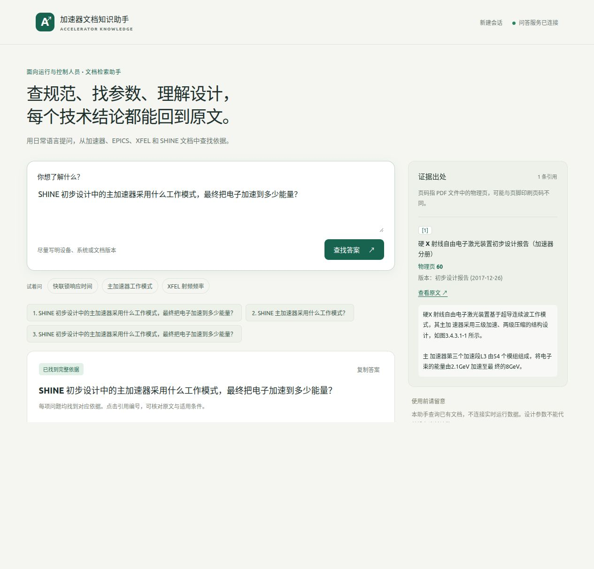
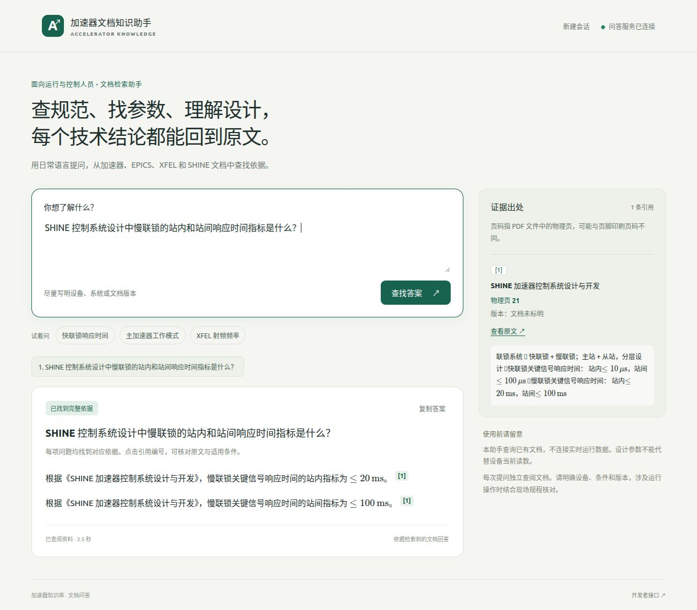

# Standalone RAG 生产就绪验收

PRODUCTION RAG: PASS

EXECUTED。验收日期：2026 年 10 月 26 日。正式服务已部署到组内 GPU 主机，正常生产入口已恢复；验收记录器不作为生产入口。

| 项目 | 最终结果 |
| --- | --- |
| Model | `qwen3.8-Flash-Next` |
| Retrieval Hit@5 | 20/21 |
| Requirement completeness | 32/33 个要求通过验证；其余要求明确标为未确认；状态计算不一致为 0 |
| 已知漏项回归 | epics-cli、shine-main-linac、shine-compressors，3/3 完整覆盖 |
| 21 条 answerable | answered 20；partial 1；insufficient 0；error 0 |
| 11 条 negative | insufficient 11；错误 answered 0；error 0 |
| 真实 HTTP | 冻结集 32/32；自由提问 10/10；合计 42/42 返回 HTTP 200 |
| Citation | 冻结集 31/31；全部问题 42/42；非法或不可解析 0 |
| 真实 PDF | 13/13 文件远端与本地哈希一致；所有引用物理页均在真实文件范围内 |
| GPU mean retrieval | 0.103 s |
| GPU mean rerank | 0.226 s |
| GPU mean generation | 2.183 s |
| GPU mean total | 2.513 s |
| Frontend | PASS |
| PDF source navigation | PASS |
| 必要回归检查 | 45 passed；Ruff、JavaScript、Shell 语法及 diff 检查通过 |

## 使用入口与运行状态

- [组内正式网页](http://10.101.9.190:8003/)。
- [本机 SSH 转发入口](http://127.0.0.1:18003/)。
- 正式目录：`/opt/accelerator-rag`。
- 正式容器：`accelerator-rag`，镜像：`accelerator-rag-runtime:20261026`。
- 正式配置：`config/rag-production.json`；启动脚本：`deploy/rag-start.sh`。
- 部署与故障处理见 [运行手册](../docs/runbooks/rag-production.md)。

实际使用物理 GPU 2，容器内为 `cuda:0`。部署前后均巡检 GPU、容器和端口。Qwen3.8 Flash 继续使用既有服务，本轮没有重启模型服务、Open WebUI 或其它业务服务。Open WebUI 不参与本产品的请求链路。

模型凭据通过仓库外权限为 `600` 的环境文件注入。支持 `ACCELERATOR_MODEL_BASE_URL`、`ACCELERATOR_MODEL_NAME` 和 `ACCELERATOR_MODEL_API_KEY`。密钥不进入代码、报告、日志或浏览器。

## 正确性契约

需求提取只接收原始问题，生成 1～6 个事实要求。ID 通过 Schema 约束为 `R1` 至 `R6`。语言与格式指令不作为事实要求，也不使用检索内容扩张用户问题。

证据选择逐项绑定当前请求的真实 span。代码拒绝不存在的 ID、重复或不一致的要求，以及没有证据却声称支持的输出。综合阶段只收到已支持要求、已验证片段、文档标题和版本；不再收到完整问题或完整检索结果。核查失败时只允许用相同证据重写一次，仍失败就删除不可靠的结论。

最终状态完全由代码计算：全部要求支持为 `answered`，部分支持为 `partial`，全部不支持为 `insufficient`。模型不输出最终状态。实时或指定时刻的运行读数、在线数量、压力、固件版本等保留确定性保护；静态设计资料不能证明实时状态。

代码检查每条 claim 中的数字是否来自它绑定的证据或文档元数据，阻止模型自行计算或添加新参数。每个关键 claim 绑定真实 span，再由代码插入请求内来源编号。涉及多文档时，来源与版本标签也由代码补齐；不同口径分别陈述，不平均、不合并。

共享结构化协议辅助模块位于 `providers/structured.py`。它展开 Schema 引用，只移除 Schema 能唯一判定的冗余数组包装。非法 JSON、未知字段和不可靠字段值不会被猜测修补。实际请求验证了单 system message、required function call、标准 tool_calls、JSON arguments 和嵌套容器兼容。

## 冻结检索与并发

保留 E5 Top-10 与 Qwen3-Embedding-0.6B Top-10 的候选并集，使用 Qwen3-Reranker-0.6B，返回 Top-5 canonical parent。没有更换模型、重算文档向量、扩大 Top-K 或修改 chunking。检索仍为 20/21。

冻结问题、证据标签、corpus 规则和 signed index contract 的哈希保持不变。`dense.py` 因请求内 trace 接口发生了授权变更，旧哈希与当前哈希单独记录于 JSON，未伪称该实现文件完全不变。

索引在启动时完整核验一次，随后禁止运行时写入；搜索不再重复扫描整库。历史评测接口仍可保留 trace，生产调用直接返回请求内 trace 和 candidates。只串行保护共享 GPU 检索，需求提取、综合与核查不受整请求全局锁限制。

正常生产入口的两个并发请求均返回 HTTP 200 和 answered，总墙钟耗时 4.02 s，请求墙钟耗时之和为 6.96 s，确认没有整请求串行。

## 真实耗时与限制

32 问平均总耗时为 2.51 s。只统计 21 条可回答问题时，平均为 3.34 s，中位数为 3.18 s。复杂说明和语义重写会超过 3 s。相比原先约 1.98 s 的摘录流程，新增需求与 claim 核查带来额外耗时；没有把负例的快速返回当作普通回答耗时。

低温 PLC/CPLD 组合问题仍保守返回 partial：主联锁 PLC 部分通过核查，CPLD 保护机制部分没有输出未获确认的结论。短问或含糊问题也可能因当前 Top-5 上下文不足而拒答。没有为提高状态数量而放宽证据边界，也没有调检索争取 21/21。

人工检查了本轮可回答问题与 10 个自由问题，没有发现已知漏项仍标 answered、外部知识补答或新增无依据的关键数字。这个结论限定于本轮样本，不代表对未知问题保证零误差。

## 网页验收

采用独立原生 JavaScript 前端，保持同源 API 和单容器部署；没有引入额外前端构建服务。Markdown、KaTeX、PDF.js 及字体资源随服务部署，运行时不依赖公网 CDN。

首页、Enter 发送、Shift+Enter 换行、重复提交禁用、加载状态、完整回答、部分回答、拒答、引用定位、原文引文、PDF 物理页、公式、中英文、刷新、页面历史和新建会话均已检查。通过临时阻断浏览器内 API 请求验证了错误提示、问题保留和恢复重试，阻断随后已移除。

桌面宽度为 1280 像素，手机宽度为 390 像素；窄屏来源区移到底部，没有横向溢出。公式使用 KaTeX，保留 LaTeX 源码，目视确认边界、单位、尺寸和引用编号正常。PDF 查看器实际显示中文原始页面并定位物理页。

原始 PDF 通过 document_id 登记表解析，浏览器不能提交文件路径。未知 ID 和编码后的绝对路径返回 404；PDF range 请求返回 206。API 不返回真实 source_path。前端不会显示检索分数、内部 trace 或模型凭据。

[手机布局截图](rag-production-readiness-20261026/mobile.png)；[原始 PDF 物理页 60 截图](rag-production-readiness-20261026/pdf-page-60.png)。

## 五类真实用户结果

以下直接保存最终 API 返回的用户答案，引用编号在每个问题内独立使用。

### 简单事实

问题：SHINE 快联锁单节点的响应时间上限是多少？

状态：answered。

根据《SHINE 加速器快联锁系统设计与开发》（核技术 47(12):120203, 2024-12），SHINE 联锁系统单节点响应时间应小于 10 µs。 [1]

同一文档（核技术 47(12):120203, 2024-12）的响应时间测试显示，单节点响应时间平均值为 328.81 ns，优于单节点响应时间 10 µs 的设计指标。 [2]

[1] 《SHINE 加速器快联锁系统设计与开发》，版本 核技术 47(12):120203 (2024-12)，物理页 2～2。[查看原文](http://10.101.9.190:8003/v1/rag/documents/shine-accelerator-fast-interlock-2024/view#page=2)

[2] 《SHINE 加速器快联锁系统设计与开发》，版本 核技术 47(12):120203 (2024-12)，物理页 7～7。[查看原文](http://10.101.9.190:8003/v1/rag/documents/shine-accelerator-fast-interlock-2024/view#page=7)

### 多子问题完整回答

问题：SHINE 初步设计中的主加速器采用什么工作模式，最终把电子加速到多少能量？

状态：answered。

《硬 X 射线自由电子激光装置初步设计报告（加速器分册）》（初步设计报告 (2017-12-26)）指出，硬X射线自由电子激光装置基于超导连续波工作模式。 [1]

《硬 X 射线自由电子激光装置初步设计报告（加速器分册）》（初步设计报告 (2017-12-26)）指出，主加速器第三个加速段L3 由54 个模组组成，将电子束的能量由2.1GeV 加速至最终的8GeV。 [1]

[1] 《硬 X 射线自由电子激光装置初步设计报告（加速器分册）》，版本 初步设计报告 (2017-12-26)，物理页 60～60。[查看原文](http://10.101.9.190:8003/v1/rag/documents/shine-accelerator-preliminary-design-report-2017/view#page=60)

### 跨语言：英文提问、中文资料

问题：Which FPGA and language does the SHINE FPIO use? Answer in English.

状态：answered。

The FPIO module's built-in FPGA uses the Xilinx Spartan-6 XC6SLX25 series chip ("SHINE 加速器快联锁系统设计与开发", 核技术 47(12):120203, 2024-12). [1]

The SHINE interlock system uses Verilog HDL for the relevant functional development ("SHINE 加速器快联锁系统设计与开发", 核技术 47(12):120203, 2024-12). [1]

[1] 《SHINE 加速器快联锁系统设计与开发》，版本 核技术 47(12):120203 (2024-12)，物理页 3～3。[查看原文](http://10.101.9.190:8003/v1/rag/documents/shine-accelerator-fast-interlock-2024/view#page=3)

### 部分回答

问题：请分别说明 SHINE 的主加速器模式、最终能量，以及此刻在线的 IOC 数量。

状态：partial。

依据 《SHINE 加速器控制系统设计与开发》（文档未标明版本）:
SHINE 的最终能量为 8 GeV。《SHINE 加速器控制系统设计与开发》给出 e-beam: 8 GeV；《EPICS IOC and PVs Information Management System for SHINE》（PCaPAC2022 FRO21）也指出其利用光电阴极电子枪结合超导直线加速器产生 8 GeV 的 FEL 品质电子束。 [1][2]

当前资料未能确认：
- SHINE 的主加速器模式是什么？
- 此刻在线的 IOC 数量是多少？

[1] 《SHINE 加速器控制系统设计与开发》，版本 unknown，物理页 6～6。[查看原文](http://10.101.9.190:8003/v1/rag/documents/shine-accelerator-control-system-design-presentation/view#page=6)

[2] 《EPICS IOC and PVs Information Management System for SHINE》，版本 PCaPAC2022 FRO21，物理页 1～1。[查看原文](http://10.101.9.190:8003/v1/rag/documents/shine-epics-ioc-pv-information-management-pcapac2022/view#page=1)

### 无法确认实时状态

问题：现在 SHINE 低温系统出口压力的实时读数是多少？

状态：insufficient。

当前知识库只包含设计文档和技术资料，无法确认实时或指定时刻的运行数据。后续可通过具备实时数据能力的 Agent 查询运行系统。

## 文件与 Git 保护

分支仍为 `whloong/agent-platform`，HEAD 仍为 `4099ce148560245acba1a8d11e2f0885ba656e11`。没有 reset、clean、checkout 覆盖、commit 或 push；没有丢失开始前的文件。已有 Agent / Waveform 内容保持不变。

正式新增文件包括稳定部署配置与脚本、共享结构化协议辅助模块、PDF 查看器、离线 Markdown / PDF.js 资源、验收工具、必要契约检查、运行手册及本报告。正式修改涉及 RAG runtime、answer、service、API、网页、请求内检索 trace、只读索引生命周期，以及 pyproject 的资源打包清单。

完整的正式新增、正式修改及历史未跟踪但非本轮文件清单见 [变更清单](rag-production-readiness-20261026/change-inventory.json)。原本就未跟踪的 RAG 文件按本轮修改记录，没有伪称新建。

## 审计材料与停止点

- [结构化最终结果](rag-production-readiness-20261026.json)。
- [模型输入边界检查](rag-production-readiness-20261026/input-audit.json)。
- [正常生产入口与并发检查](rag-production-readiness-20261026/production-checks.json)。
- [原始 PDF 哈希](rag-production-readiness-20261026/pdf-hashes.json)。
- 原始 HTTP 与模型调用记录保存在本机 `tmp/rag-production-http-results.json`，客户端回执保存在 `tmp/rag-production-http-client.json`。只将问题交给 GPU，评测标签在回答返回后才进入本地 evaluator。

本轮到此停止 standalone RAG 核心优化。后续 Knowledge Capability 与 Agent 接入不在本轮执行。
